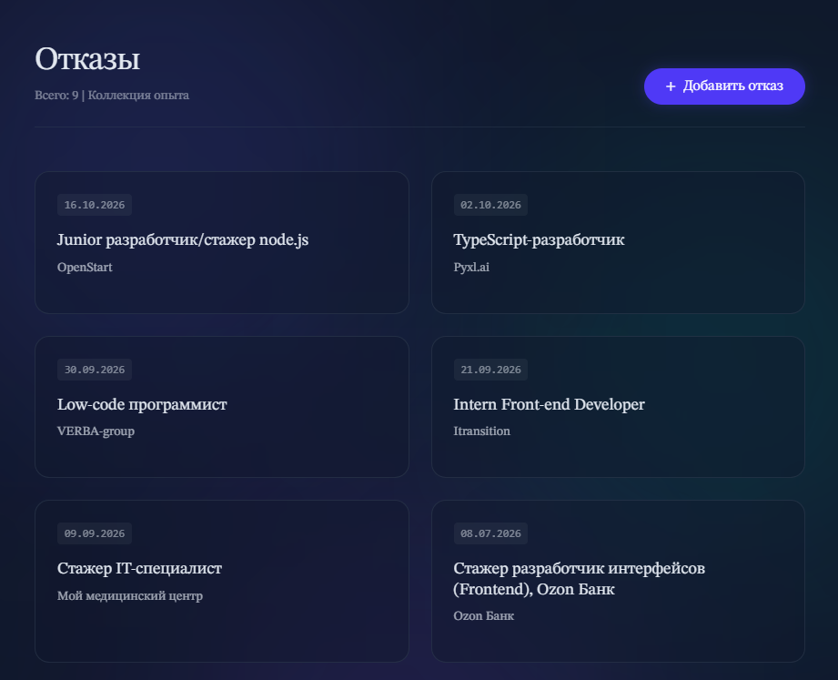
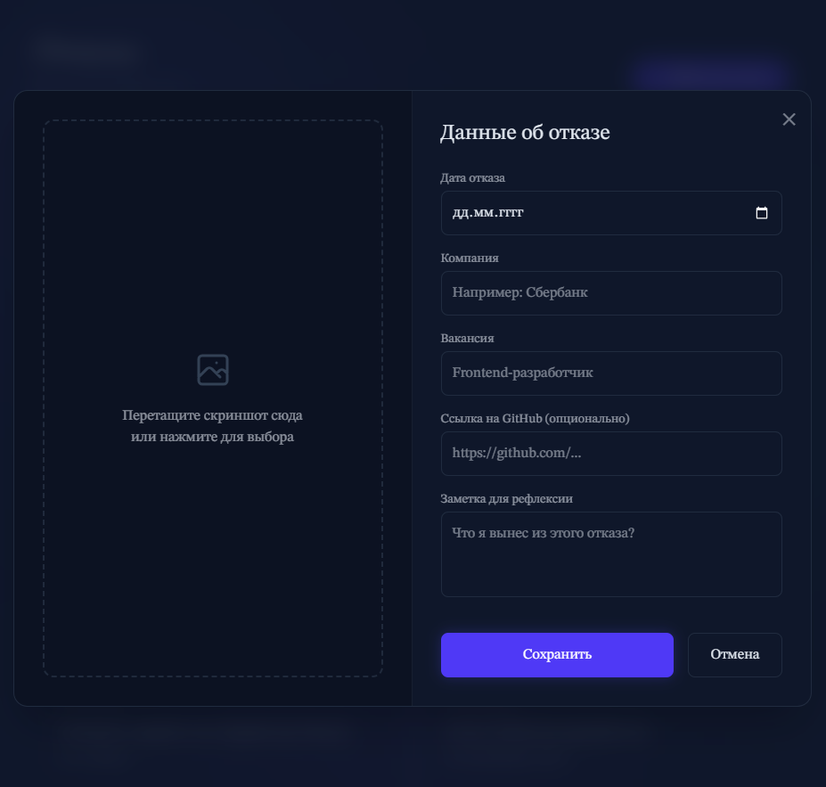

# Rejections Counter

Приложение для подсчета и аналитики отказов от работодателей. 

Главный экран (Дашборд)



Работа с файлами / AI-анализ



## Функциональность
*   **Автоматический парсинг почты:** Подключается к ящику по IMAP и сканирует входящие письма на предмет отказов с HH.
*   **Считывание и анализ файлов:** Автозаполнение в результате AI анализа файлов по отказам от других сервисов.
*   **Учет статистики:** Сохраняет данные в локальную базу данных SQLite.
*   **Наглядный дашборд:** Отображает количество отказов, динамику по времени и другие метрики (React-интерфейс).

## Технологический стек
*   **Frontend:** React, TypeScript, Vite, Tailwind CSS
*   **Backend:** Node.js, Express, TypeScript
*   **База данных:** SQLite (`better-sqlite3`)
*   **AI-интеграция:** GigaChat API
*   **Работа с почтой:** `imap`, `mailparser`, `nodemailer`

---

## Требования к окружению
*   Почтовый ящик с включенным протоколом **IMAP**
*   Доступ к API **GigaChat**

---

## Настройка и установка

### 1. Клонировать репозиторий
```bash
git clone https://github.com/Olga024/rejections_counter.git
cd rejections_counter
```

### 2. Настроить переменные окружения
В папке server создать файл .env и заполнить его вашими данными:

# Для подключения к почте
EMAIL_USER

EMAIL_PASSWORD

# Для авторизации в GigaChat API
GIGACHAT_CREDENTIALS

GIGACHAT_SCOPE

GIGACHAT_CLIENT_ID

### 3. Установить зависимости

Для сервера:
```bash
cd server
npm install
```
Для клиента:
```bash
cd ../client
npm install
```
### 4. Запуск приложения

Терминал 1 (Сервер):
```bash
cd server
npm run start
```
Терминал 2 (Клиент):
```bash
cd client
npm run dev
```
Приложение откроется на http://localhost:5173


